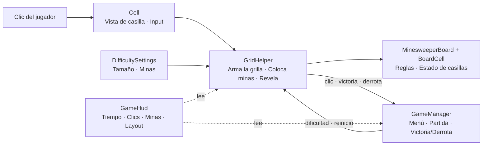

[English](README.md) · **Español**

# 💣 MineGrid


<!-- TODO: agregar los badges de plataforma y licencia cuando estén definidos -->

**El clásico Buscaminas con estética pixel art.** Leer los números, confiar en la lógica y descubrir todas las casillas seguras.

<!-- TODO: reemplazar por un GIF real de gameplay -->


[**▶ Jugar / ⬇ Descargar en itch.io**](https://emiliano-bazan-zapata.itch.io/minegrid-pixel-minesweeper)

---

## Sobre el juego

MineGrid reimagina el Buscaminas con una estética pixelada. Cada número es una pista, cada casilla revelada es una decisión y un solo movimiento equivocado termina la partida.

Se elige una dificultad, se analiza la cuadrícula y se despeja el tablero. Un cronómetro y un contador de clics registran cada partida, con un resumen al final.

## Características

- Tres tamaños de tablero, desde un desafío rápido hasta una cuadrícula amplia llena de minas.
- Minas distribuidas al azar y pistas calculadas automáticamente según las minas vecinas.
- Expansión automática por las zonas vacías conectadas.
- Pantallas de victoria y derrota con opción para reintentar o volver al menú.
- Cronómetro y contador de clics en tiempo real, con un resumen al terminar la partida.
- Tablero adaptable y compatible con las áreas seguras de la interfaz de Unity.
- Gráficos y tipografía con estilo pixel art.

### Dificultad

| Modo    | Tablero | Minas |
| ------- | ------- | ----- |
| Fácil   | 9 × 9   | 10    |
| Normal  | 16 × 16 | 40    |
| Difícil | 30 × 16 | 99    |

## Cómo jugar

1. Elegir una dificultad en el menú principal e iniciar una partida.
2. Hacer clic en una casilla cubierta para descubrirla.
3. El número indica cuántas minas rodean esa casilla, diagonales incluidas.
4. Al descubrir una casilla vacía se abren automáticamente las casillas seguras conectadas.
5. Descubrir todas las casillas seguras para ganar. Si se encuentra una mina, la partida termina.

El cronómetro empieza con el primer clic válido. El tiempo y la cantidad de clics se muestran durante la partida y en la pantalla de resultados.

## Highlights técnicos

- **Reglas separadas de la presentación:** `MinesweeperBoard` y `BoardCell` contienen las reglas del tablero y el estado de cada casilla; los componentes de Unity solo las dibujan y les pasan la entrada.
- **Distribución uniforme de minas:** las minas se colocan con un Fisher–Yates parcial, así que todas las configuraciones son igual de probables y no hace falta reintentar.
- **Dificultad en un solo lugar:** `DifficultySettings` centraliza el tamaño del tablero y la cantidad de minas de cada modo.
- **Flood fill** para revelar las zonas vacías conectadas.
- **Layout adaptable:** `GameHud` ajusta el tablero al espacio disponible y a las áreas seguras.
- **Flujo centralizado:** `GameManager` coordina los estados de menú, partida, reinicio, victoria y derrota.

## Arquitectura



| Clase                             | Responsabilidad                                                              |
| --------------------------------- | ---------------------------------------------------------------------------- |
| `MinesweeperBoard` / `BoardCell`  | Reglas del tablero y estado de cada casilla                                  |
| `Cell`                            | Vista de una casilla; pasa los clics a `GridHelper`                          |
| `GridHelper`                      | Construye la cuadrícula visual, distribuye las minas y conecta la entrada    |
| `GameManager`                     | Estados de menú, partida, reinicio, victoria y derrota                       |
| `GameHud`                         | Estadísticas de la partida y ajuste del tablero a la pantalla                |
| `DifficultySettings`              | Tamaño del tablero y cantidad de minas por modo                              |

<details>
<summary><b>Estructura del proyecto</b></summary>

```text
MineGrid/
├── Assets/
│   ├── Prefabs/       # Prefab reutilizable de una casilla
│   ├── Scenes/        # Escena principal del juego
│   ├── Scripts/       # Reglas del juego y presentación en Unity
│   └── Sprites/       # Recursos visuales con estilo pixel art
├── Packages/          # Manifiesto y archivo de bloqueo de paquetes de Unity
└── ProjectSettings/   # Configuración del proyecto y del editor
```

</details>

## Testing

Por ahora el juego se prueba manualmente: generación del tablero en las tres dificultades, números de las pistas, flood fill, condiciones de victoria y derrota, cronómetro y contador de clics, y el layout del tablero en distintas resoluciones.

## Cómo ejecutar el proyecto

### Requisitos

- [Unity Hub](https://unity.com/download)
- Unity Editor **6000.3.5f2**

### Ejecutar en local

```bash
git clone https://github.com/EmilianoBazanZapata/MineGrid.git
```

1. En Unity Hub, elegir **Add project from disk** y seleccionar la carpeta `Buscaminas/` dentro del repositorio.
2. Abrir el proyecto con Unity **6000.3.5f2**. Unity resuelve los paquetes declarados en `Packages/manifest.json`.
3. Abrir `Assets/Scenes/Game.unity`.
4. Presionar **Play**.

## Build

El juego usa una sola escena, `Assets/Scenes/Game.unity`. Para compilarlo, abrir **File > Build Profiles**, verificar que la escena esté habilitada, elegir la plataforma y presionar **Build**.

Las versiones compiladas están publicadas en [itch.io](https://emiliano-bazan-zapata.itch.io/minegrid-pixel-minesweeper). Este repositorio contiene el proyecto fuente de Unity.

## Alcance actual y próximos pasos

MineGrid es un juego completo y jugable, en desarrollo activo. Próximos pasos:

- Tests Edit Mode de las reglas del tablero: conteo de vecinas y flood fill.
- Mover la colocación de minas a `MinesweeperBoard`, para que todas las reglas vivan en una clase testeable.
- Primer clic siempre seguro.

## Créditos y assets de terceros

<!-- TODO: listar el origen de los sprites y de Fonts/Pixel-Regular.ttf con autor, link y licencia -->
Diseño y programación por Emiliano Bazán-Zapata.

## Licencia

<!-- TODO: agregar el archivo LICENSE e indicar acá la licencia elegida -->

---

**Binary Suns Studio** · [Web](https://binarysunsstudio.com.ar) · [itch.io](https://emiliano-bazan-zapata.itch.io) · [LinkedIn](https://www.linkedin.com/in/emiliano-bazán-zapata-18705721a)

¡Buena suerte! 💥
