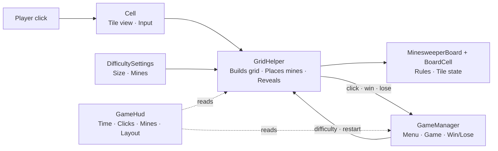

**English** · [Español](README.es.md)

# 💣 MineGrid


<!-- TODO: add platform and license badges once decided -->

**A pixel-art take on the classic Minesweeper.** Read the numbers, trust your logic and uncover every safe tile.

<!-- TODO: replace with a real gameplay GIF -->


[**▶ Play / ⬇ Download on itch.io**](https://emiliano-bazan-zapata.itch.io/minegrid-pixel-minesweeper)

---

## About the game

MineGrid reimagines Minesweeper with a pixel-art look. Every number is a clue, every tile you reveal is a decision, and one wrong move ends the run.

Pick a difficulty, read the grid and clear the board. A timer and a click counter track each run, with a summary at the end.

## Features

- Three board sizes, from a quick challenge to a wide grid full of mines.
- Randomly placed mines, with clues calculated automatically from neighbouring mines.
- Automatic flood fill across connected empty areas.
- Win and lose screens with options to retry or return to the menu.
- Real-time timer and click counter, with an end-of-run summary.
- Responsive board that respects Unity UI safe areas.
- Pixel-art graphics and typography.

### Difficulty

| Mode   | Board   | Mines |
| ------ | ------- | ----- |
| Easy   | 9 × 9   | 10    |
| Normal | 16 × 16 | 40    |
| Hard   | 30 × 16 | 99    |

## How to play

1. Choose a difficulty in the main menu and start a game.
2. Click a covered tile to reveal it.
3. A number shows how many mines surround that tile, diagonals included.
4. Revealing an empty tile automatically opens the connected safe tiles.
5. Reveal every safe tile to win. Hitting a mine ends the game.

The timer starts on the first valid click. Time and click count are shown during the game and on the results screen.

## Technical highlights

- **Rules separated from presentation:** `MinesweeperBoard` and `BoardCell` hold the board rules and tile state; Unity components only draw them and forward input.
- **Uniform mine placement:** mines are placed with a partial Fisher–Yates shuffle, so every layout is equally likely and no retries are needed.
- **Difficulty in one place:** `DifficultySettings` centralizes board size and mine count for each mode.
- **Flood fill** for revealing connected empty areas.
- **Responsive layout:** `GameHud` fits the board to the available screen space and safe areas.
- **Centralized game flow:** `GameManager` coordinates menu, game, restart, win and lose states.

## Architecture



| Class                             | Responsibility                                                       |
| --------------------------------- | -------------------------------------------------------------------- |
| `MinesweeperBoard` / `BoardCell`  | Board rules and the state of each tile                               |
| `Cell`                            | View of one tile; forwards clicks to `GridHelper`                    |
| `GridHelper`                      | Builds the visual grid, places mines and connects input to the board |
| `GameManager`                     | Menu, game, restart, win and lose states                             |
| `GameHud`                         | Run stats and fitting the board to the screen                        |
| `DifficultySettings`              | Board size and mine count per mode                                   |

<details>
<summary><b>Project structure</b></summary>

```text
MineGrid/
├── Assets/
│   ├── Prefabs/       # Reusable tile prefab
│   ├── Scenes/        # Main game scene
│   ├── Scripts/       # Game rules and Unity presentation
│   └── Sprites/       # Pixel-art visual assets
├── Packages/          # Unity package manifest and lock file
└── ProjectSettings/   # Project and editor settings
```

</details>

## Testing

The game is currently tested manually: board generation on all three difficulties, clue numbers, flood fill, win and lose conditions, timer and click counter, and the board layout at different resolutions.

## Getting started

### Requirements

- [Unity Hub](https://unity.com/download)
- Unity Editor **6000.3.5f2**

### Run locally

```bash
git clone https://github.com/EmilianoBazanZapata/MineGrid.git
```

1. In Unity Hub, choose **Add project from disk** and select the `Buscaminas/` folder inside the repository.
2. Open it with Unity **6000.3.5f2**. Unity restores the packages declared in `Packages/manifest.json`.
3. Open `Assets/Scenes/Game.unity`.
4. Press **Play**.

## Build

The game uses a single scene, `Assets/Scenes/Game.unity`. To build it, open **File > Build Profiles**, check that the scene is enabled, choose a target and press **Build**.

Compiled versions are published on [itch.io](https://emiliano-bazan-zapata.itch.io/minegrid-pixel-minesweeper). This repository contains the Unity source project.

## Current scope and next steps

MineGrid is a complete, playable game in active development. Planned next steps:

- Edit Mode tests for the board rules: neighbour counts and flood fill.
- Moving mine placement into `MinesweeperBoard`, so all rules live in one testable class.
- A safe first click.

## Credits and third-party assets

<!-- TODO: list the sources of the sprites and of Fonts/Pixel-Regular.ttf with author, link and license -->
Game design and programming by Emiliano Bazán-Zapata.

## License

<!-- TODO: add LICENSE file and state the chosen license here -->

---

**Binary Suns Studio** · [Website](https://binarysunsstudio.com.ar) · [itch.io](https://emiliano-bazan-zapata.itch.io) · [LinkedIn](https://www.linkedin.com/in/emiliano-bazán-zapata-18705721a)

Good luck! 💥
